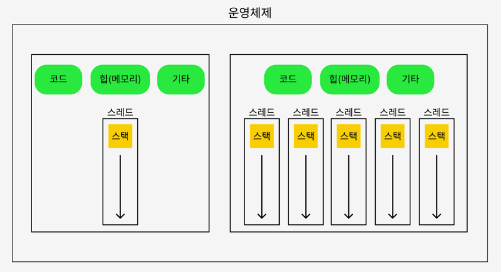

# 자바 고급 정리

> 자바 고급 강의에서 공부한 내용을 장별로 정리합니다.

## 목차
- [1장 - 프로세스와 스레드](#chapter1)

---

<b>1장 - 프로세스와 스레드</b>

## 멀티 태스킹
- **하나의 컴퓨터 시스템이 동시**에 여러 작업을 수행하는 능력을 멀티태스킹(Multitasking)이라고 한다.
- 운영체제 소프트웨어의 관점으로 **CPU 시간을 분할**하여 각 작업에 할당한다.

## 멀티 프로세싱
- 컴퓨터 시스템이 **둘 이상의 프로세서(CPU 코어)를 사용하여 여러 작업을 동시**에 처리하는 기술을 의미한다.
- 하드웨어의 관점으로 **물리적인 코어 수만큼 각 작업들이 동시 진행**된다.

## 프로세스
- 운영체제 안에서 실행중인 프로그램
- 실행중인 프로그램의 인스턴스
- 각 프로세스는 독립적인 메모리 공간을 갖고 있으며, 운영체제에서 별도의 작업 단위로 분리 후 관리
- 실행 환경과 자원을 제공하는 컨테이너 역할

### 프로세스의 메모리 구성
- 코드 섹션: 실행할 프로그램의 코드가 저장되는 영역
- 데이터 섹션: 전역 변수 및 정적 변수가 저장되는 영역
- 힙(Heap): 동적으로 할당되는 메모리 영역
- 스택(Stack): 메서드 호출 시 생성되는 지역 변수와 반환 주소가 저장되는 영역(스레드에 포함)

## 스레드(Thread)
- 프로세스는 **반드시 하나 이상의 스레드**를 포함한다.
- 프로세스 내에서 실행되는 작업의 단위로 한 프로세스 내에 여러 스레드가 존재할 수 있다.
- 프로세스 내의 스레드들은 프로세스가 제공하는 동일한 메모리 영역을 공유
- 스레드가 1개인 경우 단일 스레드, 2개 이상인 경우 멀티 스레드라고 한다.

### 스레드의 메모리 구성
- 공유 메모리: 같은 프로세스의 코드 섹션, 데이터 섹션, 힙(메모리)은 프로세스 안의 모든 스레드가 공유
- 개별 스택: 자신만의 스택을 갖고 있다.

> **프로세스와 멀티 스레드**
>  
> 우리가 유튜브를 본다고 가정해보자.
> 우리는 동영상을 시청함과 동시에 동영상에 댓글을 달고 싶을 수도 있다.
>
> 이 때, 단일 스레드의 경우에는 동영상을 멈추고 댓글을 작성하든지, 댓글을 작성하는 동안 동영상을 멈추든지 단 하나의 동작만 가능하다.
>
> 멀티 스레드의 경우에는 여러 작업을 동시에 수행할 수 있다.

### 프로세스와 스레드

## 스케줄링
- 멀티 태스킹을 하기 위해선 여러 태스크(task)를 적절하게 번갈아가며 작업해야 하는데 이를 스케줄링 기법이라고 한다.
- 모든 태스크를 정해진 시간만큼 동일하게 수행하기보다는 운영체제가 CPU를 최대한 활용할 수 있는 다양한 우선순위와 최적화 기법을 사용한다.

## 컨텍스트 스위칭(Context Switching)
- 컨텍스트는 현재 작업하는 문맥이란 의미로, **작업을 교체하기 위해 행하는 과정들을 컨텍스트 스위칭**이라고 한다.
- 현재 작업 중인 태스크를 멈출 때, 작업에 필요한 값 등을 메모리에 저장하고 다시 진행할 때 이 값들을 불러오는 작업이다.

### CPU 바운드 vs I/O 바운드
| 구분 | CPU 바운드 작업 | I/O 바운드 작업 |
|---|---|---|
| 특징 | CPU 계산이 대부분인 작업 | 파일·네트워크·DB 등의 응답을 기다리는 시간이 대부분인 작업 |
| 예시 | 복잡한 계산, 데이터 분석, 영상 처리 | 파일 읽기/쓰기, DB 조회, 네트워크 통신 |
| 적절한 스레드 수 | CPU 코어 수 정도 (더 늘리면 컨텍스트 스위칭 비용만 증가) | CPU 코어 수보다 많이 (기다리는 동안 다른 스레드가 CPU 사용) |

## ⚠️ 주의할 점
> - 멀티태스킹과 멀티프로세싱은 반대 개념이 아니다. 실제로는 둘이 함께 동작한다.
> - 스레드는 힙 등 메모리를 공유하기 때문에, 여러 스레드가 같은 데이터를 다루면 동시성 문제가 생길 수 있다.
> - 스레드가 많다고 항상 빠른 건 아니다. 컨텍스트 스위칭 비용이 있다.
> - CPU 바운드 작업은 코어 수 정도로, I/O 바운드 작업은 코어 수보다 많은 스레드로 처리하는 것이 효율적이다.

## 📌 정리
> - 멀티 태스킹은 하나의 CPU 코어에서 여러 작업을 시분할 기법으로 연속적으로 처리하는 것이다.
> - 멀티 프로세싱은 여러 CPU 코어가 여러 작업을 동시에 처리하는 것이다.
> - 프로세스는 운영체제 안에서 실행중인 프로그램의 인스턴스로 실행 환경(메모리 공간, 시스템 자원 등)을 제공한다.
> - 프로세스는 독립적인 메모리 공간을 갖고 있으며, 운영체제에서 별도의 작업 단위로 분리 후 관리한다.
> - 스레드는 반드시 한 개 이상 존재하며, 프로세스 내에 작업을 하는 단위이다.
> - 스레드는 프로세스 내의 공유 메모리 영역을 동일한 프로세스 내의 스레드들과 공유하고 자신만의 스택 영역을 갖고 있다.
> - 스케줄링은 운영체자가 여러 작업을 우선순위와 최적화 기법에 따라 태스크를 번갈아 실행하는 것이다.
> - 컨텍스트 스위칭은 작업을 바꿀 때 상태를 저장하고 불러오는 과정으로, 비용이 발생한다.

